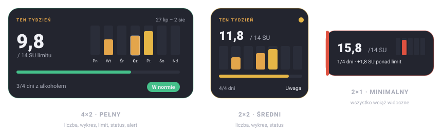
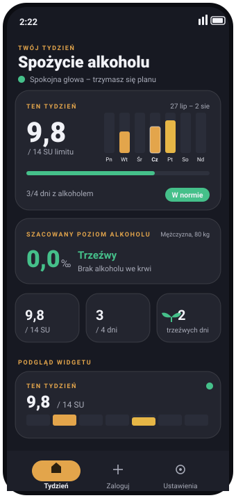
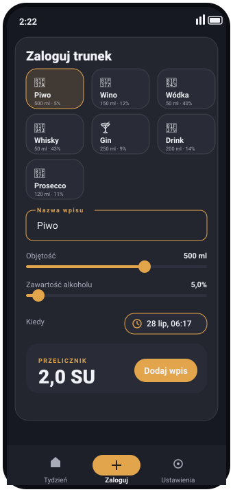
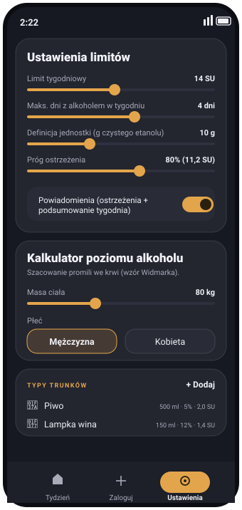
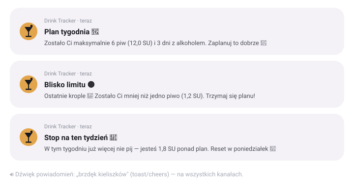

# My Drink Tracker

Śledzenie spożycia alkoholu w bieżącym tygodniu: logowanie trunków przeliczanych na
jednostki standardowe (SU), wykres dni tygodnia, limity i ostrzeżenia oraz skalowalny
widget (2×1 / 2×2 / 4×2) z najważniejszymi informacjami zawsze widocznymi.

Repozytorium zawiera dwa warianty:

- **Makiety webowe (TypeScript)** – `src/`, zbudowane w [Lovable](https://lovable.dev)
  (React + TanStack + Tailwind). Wizualizacja widgetu w trzech rozmiarach i ekranów aplikacji.
- **Natywna aplikacja Android (Kotlin)** – `android/`, pełne, działające odwzorowanie makiet
  w Jetpack Compose.

### Podgląd

Widget w trzech rozmiarach – skalowalny do 2×1 z zachowaniem wszystkich kluczowych informacji:



<table>
  <tr>
    <td align="center"><br><sub><b>Tydzień</b> · widget + BAC</sub></td>
    <td align="center"><br><sub><b>Zaloguj</b> · także wstecz</sub></td>
    <td align="center"><br><sub><b>Ustawienia</b> · kalkulator BAC</sub></td>
  </tr>
</table>

Powiadomienia „planujące" tydzień, z dźwiękiem brzdęku kieliszków:



## 📱 Aplikacja Android (`android/`)

W pełni funkcjonalna, natywna apka w Kotlinie odwzorowująca makiety i rozszerzająca je o:

- **Logowanie trunków** – gotowe typy (piwo, wino, wódka, whisky, gin, drink, prosecco),
  własne typy, suwaki objętości/mocy, przelicznik SU, historia wpisów.
- **Limity i statusy** – limit tygodniowy, maks. dni z alkoholem, próg ostrzeżenia,
  statusy `W normie / Uwaga / Przekroczono`.
- **Poziom alkoholu we krwi (BAC)** – szacowanie promili wzorem Widmarka na podstawie
  masy ciała i płci, wraz z czasem do trzeźwości.
- **Powiadomienia** – przy zbliżaniu do limitu, po jego przekroczeniu oraz cotygodniowe
  podsumowanie (WorkManager).
- **Widget na ekran główny** (Glance) – skalowalny, czyta te same dane.
- **Fancy smaczek** – złoty „shimmer" na głównej liczbie, rotujące dowcipne hasła, licznik
  trzeźwych dni z odznakami oraz powiadomienia z charakterem.

Stack: Jetpack Compose (Material 3) · Glance · DataStore · WorkManager · minSdk 26 / targetSdk 36.

### Budowanie

```sh
cd android
./gradlew :app:assembleDebug
# APK: android/app/build/outputs/apk/debug/app-debug.apk
```

Gotowy plik APK dostępny jest też w sekcji [Releases](../../releases).
Szczegóły w [`android/README.md`](android/README.md).

## 🌐 Makiety webowe (`src/`)

This project was built with [Lovable](https://lovable.dev).

## Build with Lovable

Continue developing this project in the [Lovable editor](https://lovable.dev/projects/4d99f760-d174-4881-8dd7-f35e587999b1).

- **Ship faster**: describe what you want to build and Lovable handles the code.
- **Stay in sync**: every change made in Lovable is committed straight to this repository.
- **Full ownership**: this code is yours. Push to `main` on GitHub and your changes sync back into Lovable, ready for your next prompt.

## Development

Prefer working locally? You need Node.js and npm — [install with nvm](https://github.com/nvm-sh/nvm#installing-and-updating).

```sh
git clone <this-repository-url>
cd <repository-name>
npm i
npm run dev
```
