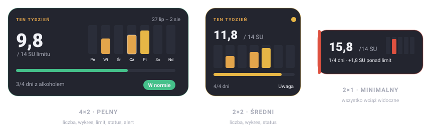
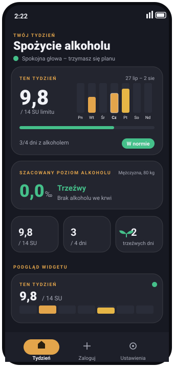
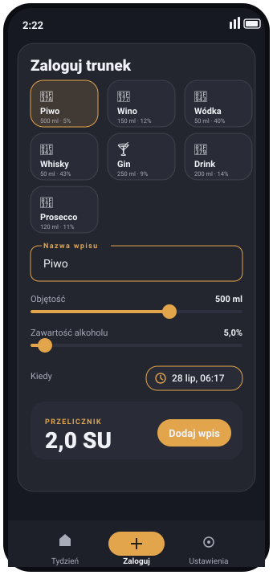
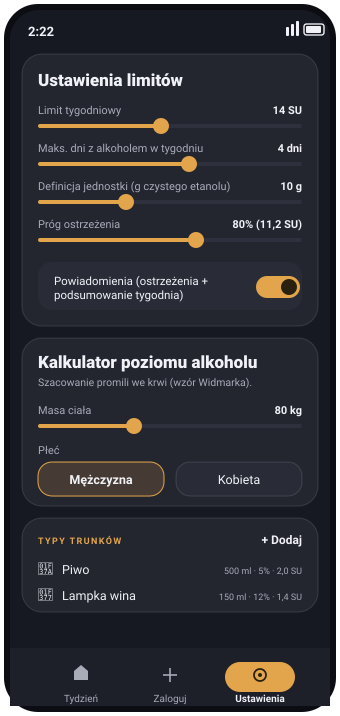
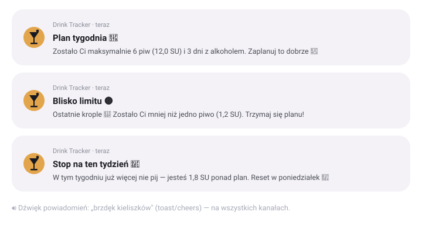

# Drink Tracker — natywna aplikacja Android (Kotlin)

Natywne odwzorowanie makiet z projektu TypeScript (`../src`) jako w pełni działająca
aplikacja w Jetpack Compose. Śledzi tygodniowe spożycie alkoholu w jednostkach
standardowych (SU), pokazuje wykres dni, statusy limitu i skalowalny widget na ekran główny.

## Podgląd

Widget w trzech rozmiarach – skalowalny do 2×1 z zachowaniem wszystkich kluczowych informacji:



<table>
  <tr>
    <td align="center"><br><sub><b>Tydzień</b> · widget + BAC</sub></td>
    <td align="center"><br><sub><b>Zaloguj</b> · także wstecz</sub></td>
    <td align="center"><br><sub><b>Ustawienia</b> · kalkulator BAC</sub></td>
  </tr>
</table>

Powiadomienia „planujące" tydzień, z dźwiękiem brzdęku kieliszków:



## Funkcje

- **Odwzorowanie makiet** – ten sam design (ciemny motyw, złoty akcent), przelicznik
  SU = objętość × %ABV × 0,789 / g_na_jednostkę, statusy `W normie / Uwaga / Przekroczono`,
  widget w rozmiarach 2×1, 2×2 i 4×2 (wszystkie kluczowe informacje widoczne nawet w 2×1).
- **Logowanie trunków** – gotowe typy (piwo, wino, wódka, whisky, gin, drink, prosecco),
  suwaki objętości i mocy, własne typy trunków, edytowalna nazwa wpisu, historia z usuwaniem.
- **Logowanie wstecz** – selektor „Kiedy" z wyborem daty i godziny (Material 3 Date/Time Picker);
  wpis trafia na właściwy dzień tygodnia i nie zawyża bieżącego promila.
- **Ustawienia limitów** – limit tygodniowy, maks. dni z alkoholem, definicja jednostki (g etanolu),
  próg ostrzeżenia, przełącznik powiadomień.
- **Poziom alkoholu we krwi (BAC)** – szacowanie promili wzorem Widmarka na podstawie
  **masy ciała** i płci: `BAC(‰) = g_etanolu / (masa_kg × r) − 0,15 × godziny`.
  Karta pokazuje promile, ocenę słowną i czas do trzeźwości.
- **Powiadomienia z planowaniem tygodnia** – po każdym wpisie podpowiadają, ile jeszcze możesz
  wypić, przeliczając pozostały limit na konkretne piwa: „Zostało Ci maksymalnie 2 piwa (…SU),
  zaplanuj to dobrze 📅", a po przekroczeniu „Stop na ten tydzień 🛑 — już więcej nie pij".
  - **Zbliżanie do limitu / przekroczenie** – kanał wysokiego priorytetu (heads-up).
  - **Podsumowanie tygodnia** – cyklicznie w niedzielę o 20:00 (WorkManager).
  - **Własny dźwięk** – „brzdęk kieliszków" (toast/cheers) generowany syntetycznie,
    podpięty do wszystkich kanałów (`res/raw/clink_cheers.wav`).
- **Widget na ekran główny** (Glance) – skalowalny; czyta te same dane, klik otwiera aplikację.
- **Fancy smaczek** – złoty „shimmer" przesuwający się po głównej liczbie, rotujące dowcipne
  hasła zależne od statusu, licznik trzeźwych dni z odznakami (🌱⭐🔥🥇🏆) oraz powiadomienia
  z charakterem (np. „Limit macha białą flagą 🏳️", „Twoja wątroba przybija Ci piątkę 🖐️").

## Stack

Kotlin • Jetpack Compose (Material 3) • Glance (widget) • DataStore (dane) •
WorkManager (podsumowanie tygodnia) • minSdk 26 • targetSdk 36.

## Budowanie

```bash
cd android
./gradlew :app:assembleDebug
```

APK: `app/build/outputs/apk/debug/app-debug.apk`. Instalacja: `adb install -r <apk>`.
Lub otwórz folder `android/` w Android Studio i uruchom konfigurację `app`.

## Struktura

```
app/src/main/kotlin/com/devqube/drinktracker/
├── data/          # domena: Alcohol, Bac (Widmark), Week, Store (DataStore), Fancy
├── ui/            # Compose: AppRoot (nawigacja), ekrany, komponenty, motyw
├── notifications/ # Notifier, LimitChecker, WeeklySummaryWorker
├── widget/        # Glance AlcoholGlanceWidget + receiver
├── MainActivity.kt
└── DrinkTrackerApp.kt
```
